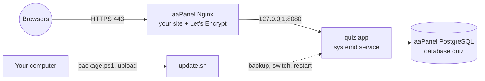

# Deploying on aaPanel

This page runs the platform on a server managed with [aaPanel](https://www.aapanel.com), using aaPanel's own PostgreSQL for the data. It also covers updating to a new version later, built on your computer, without losing data and without signing anyone out.



Your computer builds everything: the server needs neither Go nor Node. You upload one file and run one command.

## What you need

- aaPanel on a Linux server with systemd (Ubuntu 20.04+, Debian 11+, AlmaLinux or Rocky 8+). 2 GB of memory or more.
- From aaPanel's **App Store**: **Nginx**, and **PostgreSQL 16** (or 15; 13 at least).
- A domain or subdomain whose DNS `A` record points at the server, for example `quiz.school.edu`.
- On your computer: this project, and the tools from [Getting started](/docs/getting-started) (Go and Node).

## 1. Create the database

In aaPanel, go to **Databases → PgSQL → Add database**:

| Field | Value |
|---|---|
| Database name | `quiz` |
| Username | `quiz` |
| Password | a long random one (aaPanel can generate it); note it down |
| Access | Local server (127.0.0.1) |

The app creates its tables itself on first start, and later changes them itself when a new version needs it.

## 2. Create the website

1. **Website → Add site.** Enter your domain, and choose **Static** (no PHP) and no database.
2. Open the site's **SSL** tab, choose **Let's Encrypt**, issue the certificate, and turn on **Force HTTPS**.

## 3. Build the package on your computer

In PowerShell, from the project folder:

```powershell
.\scripts\package.ps1
```

This makes `dist\quiz-<version>-linux-amd64.tar.gz` and a `.sha256` file beside it. For an ARM server, use `.\scripts\package.ps1 -Arch arm64`.

## 4. Upload and install

1. In aaPanel's **Files**, upload both files (the `.tar.gz` and the `.sha256`) to `/root`.
2. In aaPanel's **Terminal** (or over SSH as root), run:

   ```bash
   cd /root
   mkdir -p quiz-install && tar -xzf quiz-*-linux-amd64.tar.gz -C quiz-install
   bash quiz-install/install.sh quiz-*-linux-amd64.tar.gz
   ```

3. Answer its questions:
   - your **domain**;
   - the **database name, user and password** from step 1 (host `127.0.0.1`, port `5432`);
   - the **port for the app** (`8080`, unless something else on the server uses it).

**What `install.sh` sets up:**

| What | Where |
|---|---|
| A `quiz` system user | |
| The app | `/www/quiz-app` |
| The settings | `/www/quiz-app/config/quiz.env` |
| A new master key | `/www/quiz-app/config/kek.key` |
| A `quiz` service that starts at boot | systemd |

It then starts the app. Running it again later is safe: it keeps the settings and the key.

## 5. Point the website at the app

1. Open the site's **Config** in aaPanel (Website → your site → Config).
2. **Delete** these blocks. They would serve the app's scripts and images from the empty site folder, and every page would break:
   - `location ~ .*\.(gif|jpg|jpeg|png|bmp|swf)$ { … }`
   - `location ~ .*\.(js|css)?$ { … }`
   - any `location / { … }`

   Keep the SSL lines, and the `/.well-known` block that renews the certificate.
3. Paste the contents of `/www/quiz-app/nginx.conf` inside the `server { … }` block, below the SSL lines. To show it, run `cat /www/quiz-app/nginx.conf` in the terminal.
4. Save. aaPanel checks the config and reloads Nginx.

**What that config does:**
- sends pages, the API and live connections to the app;
- keeps WebSockets open, for live quizzes, polls and meetings;
- adds the same security headers as the other setups.

Open `https://your-domain`. You should see the login page.

## 6. Make the first admin, and keep the key safe

```bash
bash /www/quiz-app/admin.sh you@school.edu "Your Name"
```

It asks for the password. Then sign in at `https://your-domain/login`.

**Save `/www/quiz-app/config/kek.key` somewhere safe, off the server:** a password manager, or an encrypted USB stick. It encrypts stored LLM keys, sign-in provider secrets and Google Drive connections. A database backup restored without it loses those, though everything else is fine.

## Updating to a new version

Each time you've added features locally and released them (merged into `main`):

1. **On your computer:**
   ```powershell
   .\scripts\package.ps1
   ```
2. **Upload** the new `.tar.gz` and `.sha256` to `/root` with aaPanel's Files.
3. **On the server:**
   ```bash
   bash /www/quiz-app/update.sh /root/quiz-<version>-linux-amd64.tar.gz
   ```

`update.sh` keeps everything:

| Step | What it does |
|---|---|
| Checks the package | Refuses a file damaged on the way (`.sha256`) |
| Backs up the database | `pg_dump` to `/www/quiz-app/backups/before-<version>-<time>.dump`, keeping the last 10 |
| Unpacks beside the old one | Each version in `/www/quiz-app/releases/<version>`; the last 5 are kept |
| Switches and restarts | The new version applies its database changes itself as it starts |
| Checks it's up | If it doesn't answer within 90 seconds, switches back to the previous version and restarts that |

**What people notice:**

- **Signed-in people stay signed in.** Sessions are kept in the database, not in the app's memory.
- **Students in a live quiz** see "Reconnecting…" for a few seconds. Their answers are already saved, and the quiz carries on.
- **Live polls and meetings** reconnect by themselves. A meeting's whiteboard, though, is kept in memory and is cleared: update between lessons, or download the board first.
- **Nothing else is lost:** classrooms, quizzes, results, polls and uploaded files are all in the database.

To see which version is running:

```bash
cat /www/quiz-app/current/VERSION
```

## Going back

**To the previous version**, when the new one misbehaves but its database changes are harmless:

```bash
ls /www/quiz-app/releases
ln -sfn /www/quiz-app/releases/<older-version> /www/quiz-app/current
systemctl restart quiz
```

**And its data**, when the new version changed the database and the old one can't use it: restore the backup taken just before the update.

```bash
systemctl stop quiz
set -a; . /www/quiz-app/config/quiz.env; set +a
/www/server/pgsql/bin/pg_restore --clean --if-exists --no-owner --single-transaction \
  --dbname="$QP_DATABASE_URL" /www/quiz-app/backups/before-<version>-<time>.dump
ln -sfn /www/quiz-app/releases/<older-version> /www/quiz-app/current
systemctl start quiz
```

This removes anything written since the update.

## Backups

Keep more than the dumps taken before updates:

- **aaPanel → Cron → Backup Database:** a daily backup of the `quiz` PgSQL database, kept for a couple of weeks. Send it to remote storage too (aaPanel supports S3, FTP and others).
- **The app's own backups:** made from **Admin → Backups** in the platform, encrypted with a passphrase you choose, stored in `/www/quiz-app/data/backups`. See [Deployment](/docs/deployment#restoring-a-backup).
- **The master key and the settings:** `/www/quiz-app/config/`, once, off the server.

## Day to day

| Task | Command |
|---|---|
| Is it running? | `systemctl status quiz` |
| Its log, live | `journalctl -u quiz -f` |
| Restart | `systemctl restart quiz` |
| Change a setting | edit `/www/quiz-app/config/quiz.env`, then restart |

To send password-reset and verification emails:
1. Uncomment the `QP_SMTP_*` lines in `quiz.env` and fill them in.
2. Put the SMTP password in `/www/quiz-app/config/smtp_password` (mode 600).
3. Restart.

Never delete `/www/quiz-app/config` or the `quiz` database in aaPanel. Uninstalling the site in aaPanel doesn't touch either; it only removes the Nginx site.

## Tutoring's relay on port 443

If you run tutoring (see [Deployment](deployment.md)) and students sit behind school firewalls that let only HTTPS out, LiveKit's relay has to share port 443 with your websites. With aaPanel's nginx, its stream module splits 443 by name: `deploy/aapanel/nginx-turn.conf` holds the configuration and the steps (D-83). It moves **every** HTTPS site on the server to an internal port, so plan a quiet moment, and check the sites' `listen` lines again after changing their SSL settings in aaPanel, which rewrites them. This configuration hasn't been tried on aaPanel itself; the same split was tested with Caddy.

## Troubleshooting

| What you see | Why, and what to do |
|---|---|
| **502 Bad Gateway** | The app isn't running. Check `journalctl -u quiz -n 50`. The port in `nginx.conf` must match `QP_LISTEN` in `quiz.env` |
| **The login page loads without its style, or pages are blank** | aaPanel's static-file blocks are still in the site config (step 5). Remove them |
| **"cross-site request rejected" at login** | `QP_BASE_URL` in `quiz.env` must be exactly the address people use: `https://`, with or without `www.` as they type it. Fix it and restart |
| **Live quizzes keep "Reconnecting…"** | Nginx isn't passing WebSockets. Check the `Upgrade` and `Connection` lines from `nginx.conf` are in the site config |
| **Install or update says it can't sign in to the database** | The password or user is wrong, or the database's access isn't "Local server". Check in aaPanel → Databases → PgSQL |
| **The log says `permission denied to create extension "pgcrypto"`** | Create it once as PostgreSQL's administrator, then restart: `sudo -u postgres /www/server/pgsql/bin/psql -d quiz -c 'CREATE EXTENSION IF NOT EXISTS pgcrypto'` |
| **"pg_dump not found"** | Install PostgreSQL from aaPanel's App Store on this server. If the database is elsewhere, install the matching client tools and set `QP_PG_BIN` to their folder |
| **An update went back to the old version** | It printed why; the log is in `journalctl -u quiz -n 80`. Your data is as it was, and there's a backup from just before |
