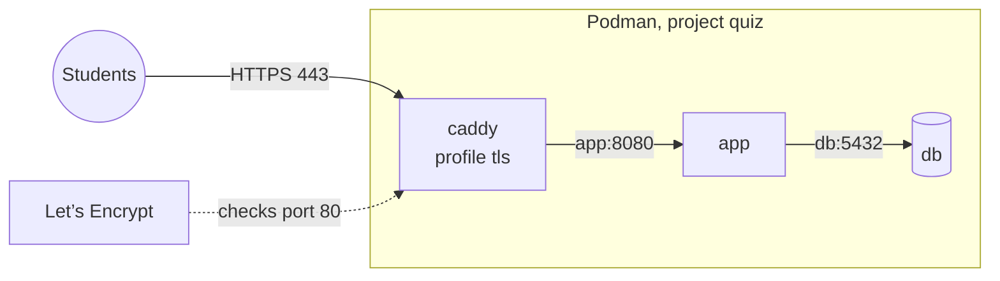

# Deploying with Podman and HTTPS

This page sets the platform up on a Linux server with Podman, with HTTPS from a free Let's Encrypt certificate. It uses the same `compose.yaml` as Docker (D-37): Caddy, in the compose `tls` profile, gets and renews the certificate by itself. The whole setup takes about 20 minutes.

Why HTTPS at all: logins use a `__Host-` session cookie, which browsers keep only on HTTPS (ADR-13). Without it, students are logged out as soon as they log in.

## What you need

- A Linux server with a public IP, for example a VPS. Fedora, RHEL, Rocky, Debian and Ubuntu all work.
- **Podman 4.4 or newer** (`podman --version`), with a compose provider: `podman-compose`, or Docker's `docker-compose`. `podman compose` (Podman 4.7+) runs whichever one is installed.
- **A name for the server.** Either your own domain with a DNS `A` record pointing at the server's IP (`quiz.example.edu → 203.0.113.5`), or a free [sslip.io](https://sslip.io) name such as `203-0-113-5.sslip.io`, which needs no DNS setup. See [Deploying without a domain](/docs/deploy-without-domain) for setups without a public IP.
- **Ports 80 and 443 reaching the server.** Let's Encrypt checks the name on port 80, and the app is served on 443.



## 1. Install Podman

```bash
# Fedora, RHEL, Rocky
sudo dnf install -y podman podman-compose git
# Debian 12+, Ubuntu 22.04+
sudo apt install -y podman podman-compose git
```

## 2. Choose rootful or rootless

| | Rootful (`sudo podman …`) | Rootless (your own user) |
|---|---|---|
| Ports 80 and 443 | Work as they are | Need one extra setting (below) |
| Students' own addresses reach the app | Yes | Depends on the Podman version (see [Check the client addresses](#check-the-client-addresses)) |
| Container escapes | Land as root | Land as your user |
| Start on boot | A system unit | A user unit and lingering |

For a server that only runs this platform, **rootful is simpler**. Choose rootless when the server is shared or you prefer the smaller blast radius. The commands below are written for rootless; for rootful, put `sudo` in front of every `podman` command and skip the rootless-only steps.

**Rootless only: let your user bind ports 80 and 443.** By default only root can use ports below 1024:

```bash
echo 'net.ipv4.ip_unprivileged_port_start=80' | sudo tee /etc/sysctl.d/90-quiz-ports.conf
sudo sysctl --system
```

If you'd rather not change this, set `CADDY_HTTP_PORT=8081` and `CADDY_HTTPS_PORT=8443` in `.env` and forward 80 and 443 to them in the firewall. Let's Encrypt still needs the outside ports to be 80 and 443.

**Rootless only: allow CPU limits.** `compose.yaml` limits memory, and LiveKit's CPU too when tutoring is on. Rootless containers can set CPU limits only if systemd delegates the `cpu` controller to users. Without it, the tutoring containers fail with "the requested cgroup controller `cpu` is not available":

```bash
sudo mkdir -p /etc/systemd/system/user@.service.d
printf '[Service]\nDelegate=cpu cpuset io memory pids\n' | sudo tee /etc/systemd/system/user@.service.d/delegate.conf
sudo systemctl daemon-reload   # then log out and back in
```

## 3. Open the firewall

```bash
# firewalld (Fedora, RHEL, Rocky)
sudo firewall-cmd --permanent --add-service=http --add-service=https --add-port=443/udp
sudo firewall-cmd --reload
# ufw (Debian, Ubuntu)
sudo ufw allow OpenSSH && sudo ufw allow 80/tcp && sudo ufw allow 443/tcp && sudo ufw allow 443/udp && sudo ufw enable
```

Also allow 80 and 443 in your hosting provider's firewall, if it has one. UDP 443 is optional (HTTP/3).

## 4. Configure

```bash
git clone https://github.com/nadun96/quizare.git quiz && cd quiz
cp .env.example .env
chmod 600 .env
```

Edit `.env`:

```
POSTGRES_PASSWORD=a-long-random-password       # e.g. openssl rand -hex 24
QP_DOMAIN=quiz.example.edu                     # or 203-0-113-5.sslip.io
QP_BASE_URL=https://quiz.example.edu           # the same name, with https://
```

`QP_BASE_URL` must be exactly the address students open: the app accepts logins only from it, and puts it in the QR codes. Keep `QP_HTTP_BIND=127.0.0.1:8080`, so the app is reachable only through Caddy.

## 5. Start

```bash
podman compose --profile tls up -d --build
podman compose logs caddy        # look for "certificate obtained successfully"
```

The first build takes a few minutes. The certificate usually arrives within a minute of Caddy starting. If the log shows certificate errors instead, see [Troubleshooting](#troubleshooting) before retrying: Let's Encrypt allows only a few failed attempts per hour.

Some `podman-compose` versions start containers without waiting for the database to be healthy. That's expected: the app retries the database for 90 seconds (`QP_DB_WAIT_SECONDS`).

## 6. Create the first admin

The password is read from standard input, so it doesn't end up in the shell history:

```bash
read -rs PW && echo "$PW" | podman compose exec -T app /app/server create-admin you@school.edu "Your Name"; unset PW
```

If your compose provider has no `exec -T`, use the container's name from `podman ps` (`quiz_app_1` or `quiz-app-1`): `echo "$PW" | podman exec -i quiz_app_1 /app/server create-admin …`.

Then open `https://quiz.example.edu/login` and log in. The admin console is at `/admin`.

## 7. Turn on HSTS

Once the site works on HTTPS with a real name, tell browsers to always use HTTPS. In `deploy/container/Caddyfile`, add this line inside the first block's `header { … }`:

```
Strict-Transport-Security "max-age=31536000"
```

Then `podman compose --profile tls up -d` again. Don't add it while testing with `localhost` or an IP address: browsers remember it for a year.

## 8. Start on boot

`restart: unless-stopped` restarts containers that crash, but Podman has no daemon to start them after a reboot. A small systemd unit does that.

Rootless: save this as `~/.config/systemd/user/quiz.service`, with `WorkingDirectory` set to where you cloned the repository:

```ini
[Unit]
Description=Classroom Quiz (Podman compose)
Wants=network-online.target
After=network-online.target

[Service]
Type=oneshot
RemainAfterExit=yes
WorkingDirectory=%h/quiz
ExecStart=/usr/bin/podman compose --profile tls up -d
ExecStop=/usr/bin/podman compose --profile tls stop

[Install]
WantedBy=default.target
```

```bash
systemctl --user daemon-reload
systemctl --user enable --now quiz.service
sudo loginctl enable-linger "$USER"     # start your user's services at boot, without logging in
```

Rootful: save the same unit as `/etc/systemd/system/quiz.service`, with `WorkingDirectory=/root/quiz` (or wherever the repository is) and `WantedBy=multi-user.target`, then `sudo systemctl enable --now quiz.service`.

Reboot once and check with `podman ps` that `caddy`, `app` and `db` are running.

## Check the client addresses

The app counts login attempts and quiz joins per student network (D-51). It learns each student's address from Caddy, which gets it from Podman's port forwarding. Rootful Podman always passes the real address. Rootless Podman passes it with `pasta`, the default from Podman 5, but older versions using `slirp4netns` show every student as the same address.

To check, turn on Caddy's access log for a moment: add a line `log` inside the first block of `deploy/container/Caddyfile`, then

```bash
podman compose --profile tls up -d --force-recreate caddy
# open the site from your phone on mobile data, then:
podman compose logs caddy | grep -o '"remote_ip":"[^"]*"' | tail -3
```

Remove the `log` line again afterwards and recreate Caddy the same way. If `remote_ip` shows your phone's public address, you're done. If it shows an address such as `10.0.2.100` or `127.0.0.1` for everyone, the whole class shares one limit. That limit is generous (150 joins at once, then 4 a second), but switching to rootful Podman or Podman 5 is better for big schools.

## Tutoring sessions (optional)

Tutoring needs a second name, for example `tutor.quiz.example.edu`, pointing at the same server, and two more open ports for video:

```bash
sudo firewall-cmd --permanent --add-port=7881/tcp --add-port=7882/udp && sudo firewall-cmd --reload
# or: sudo ufw allow 7881/tcp && sudo ufw allow 7882/udp
```

Add to `.env`:

```
QP_TUTOR_DOMAIN=tutor.quiz.example.edu
QP_TUTORING_URL=https://tutor.quiz.example.edu
QP_TUTORING_MEDIA_URL=wss://tutor.quiz.example.edu
```

Then start with both profiles, and use the same two profiles in the boot unit:

```bash
podman compose --profile tls --profile tutoring up -d --build
```

If your compose provider ignores the health conditions, LiveKit may start before the tutoring service has written its key file and exit once. Its restart policy starts it again a few seconds later.

## Upgrades

```bash
cd ~/quiz && git pull
podman compose --profile tls up -d --build
podman image prune -f
```

Migrations run when the app starts. Upgrade between classes: students reconnect on their own, but a lesson is a bad time to find a problem.

## Backups

- **From the admin console:** Admin → Backups makes an encrypted backup and offers it for download. Keep the download off the server.
- **Volumes:** the database lives in the `quiz_pgdata` volume and the master key in `quiz_appdata`. Without the master key, saved LLM API keys can't be read, so back up both together:

  ```bash
  podman compose stop app
  podman volume export quiz_appdata -o appdata.tar
  podman compose exec -T db pg_dump -U quiz -Fc quiz > quiz.dump
  podman compose start app
  ```

Rootless volumes are under `~/.local/share/containers/storage/volumes/`, rootful ones under `/var/lib/containers/storage/volumes/`.

## Troubleshooting

| Symptom | Cause and fix |
|---|---|
| `rootlessport cannot expose privileged port 80` | Rootless Podman can't bind ports below 1024. Set `net.ipv4.ip_unprivileged_port_start=80` ([step 2](#2-choose-rootful-or-rootless)), or use `CADDY_HTTP_PORT`/`CADDY_HTTPS_PORT`. |
| Caddy logs certificate errors (`timeout`, `connection refused`, `NXDOMAIN`) | The name doesn't point at this server, or port 80 doesn't reach it. Check the DNS record (`dig +short quiz.example.edu`), the server firewall and the provider's firewall. |
| "cross-site request rejected" when logging in | The browser's address isn't exactly `QP_BASE_URL`. Open that address, or fix `.env` and run `podman compose --profile tls up -d`. |
| Logged in, then logged out straight away | The page isn't on HTTPS. Open the `https://` address. |
| `Permission denied` reading the Caddyfile | SELinux. The compose file labels it with `:Z`; if you moved the repository, check `ls -Z deploy/container/Caddyfile` and run `restorecon -Rv .`. |
| `the requested cgroup controller cpu is not available` | Rootless without CPU delegation: see [step 2](#2-choose-rootful-or-rootless). |
| `short-name resolution enforced` | Shouldn't happen: every image in `compose.yaml` has its full `docker.io/…` name. If you added one, give it the full name too. |
| `Error: IPAM error: requested ip address 172.31.250.10 is already allocated` or a subnet clash | Another network uses `172.31.250.0/24`. Set `QP_COMPOSE_SUBNET` and `QP_CADDY_IP` in `.env` to a free subnet, for example `172.31.251.0/24` and `172.31.251.10`. |
| Nothing runs after a reboot | The boot unit isn't enabled, or lingering is off for a rootless user ([step 8](#8-start-on-boot)). `systemctl --user status quiz.service` shows why. |
