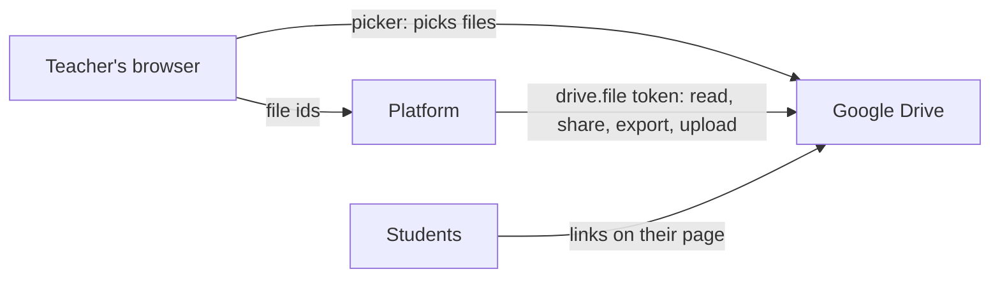

# Google Drive

Teachers can connect their own Google Drive (D-71) to:

- **attach Drive files to a classroom**: notes, worksheets and slides that students open from their page;
- **put Drive images and documents in questions**: an image on the question, an option or the feedback, or a link in the question text;
- **import questions** from a CSV file or a Google Sheet in Drive;
- **save results to Drive** as Google Sheets: a session's or a poll's results when they ask, and optionally every session's when it ends.

An admin sets up the platform's Google app once, in **Admin → Google Drive**. Each teacher then connects their own Drive from **Settings → Google Drive**.

## Only the files a teacher chooses

Teachers grant the `drive.file` scope only. The platform can open the files they choose in Google's file picker, and the ones it makes itself (the results folder and its sheets), never the rest of their Drive. Google treats `drive.file` as non-sensitive, so the app needs no security assessment by Google.

Each teacher's refresh token is sealed with the master key (ADR-09), as LLM keys are. When a teacher disconnects, the platform revokes the token with Google. If they remove the platform's access in their Google account instead, the next use finds out, and their settings page asks them to reconnect.



## Classroom files

On a classroom's **Files** tab, **Add from Drive** opens the picker; teachers can choose several files at once. Each file is shared in one of three ways:

| Sharing | What the platform does in Drive |
|---|---|
| **Students in this class** | Adds each actively enrolled student's email as a reader. Every 15 minutes, it adds students who joined and removes students who left. |
| **Anyone with the link** | Adds one "anyone with the link can view" permission. Students need no Google account. |
| **As it is in Drive** | Changes nothing; the teacher shares the file in Drive. |

Students see the files under their classroom on **My quizzes**. Removing a file from the classroom takes back only the sharing the platform added; the file stays in the teacher's Drive.

**Students without a Google account.** Drive can share only with an email that has a Google account, unless it sends an invitation. The platform never sends Google invitations. Those students are skipped, and the file says how many there are; use **Anyone with the link** for such classes, or Google Workspace for Education accounts.

## Questions

- **Images:** in a question's **Resources**, **From Drive** picks an image, shares it by link and fills in the URL. Drive links become embeddable thumbnails, as pasted Drive links always have (BR-15: files are referenced, never stored here).
- **Documents:** the question editor's **Drive file** button (next to Link) picks a file, shares it by link, and inserts a link to it. Selected text becomes the link's text; otherwise the file's name does.

Both share the file with anyone who has the link, so students can open it without a Google account.

## Importing questions

On a quiz's **Import** tab, **Import from Google Drive** takes a CSV file or a Google Sheet, whose first sheet is read as CSV. The columns, checks and 2 MB limit are those of the CSV upload; rows with problems are listed.

## Presentations

On a presentation's **Slides** tab, teachers who connected Drive can upload a PowerPoint (.pptx, .ppt), OpenDocument (.odp) or Keynote file, or choose **From Drive** for Google Slides, a PDF or a PowerPoint file in their Drive (D-78). The platform puts an uploaded file in the teacher's Drive as Google Slides, exports it as a PDF, and deletes that copy; the browser then turns the PDF into slides as for any PDF. Files up to 100 MB go in; the PDF that comes out must be at most 50 MB. Exports over Drive's 10 MB export limit come through the file's export link instead. Without Drive, PowerPoint files must be saved as PDF first; nothing on the server converts them.

## Results

**Save to Drive** on a session's results, on a poll's results tab, or on a presentation's **Against marks** tab (its viewing records, D-78), uploads the same CSV as **Export CSV**, converted to a Google Sheet, into a folder named *Classroom Quiz results*. If that folder was deleted, the next save makes a new one.

With **Results: After each session** in their Drive settings, a session's results are saved when it ends. The save is a background job that retries for about an hour if Google is unreachable, and saves once only. The settings page lists recent saves with links, including failed ones and why they failed.

## Setting up the Google app

In the [Google Cloud console](https://console.cloud.google.com):

1. Create a project, and enable the **Google Drive API** and the **Google Picker API**.
2. **OAuth consent screen:** choose *Internal* for Google Workspace (only your school's accounts) or *External*. Add the scope `https://www.googleapis.com/auth/drive.file`.
3. **Credentials → OAuth client ID → Web application.**
   - Authorised redirect URI: `https://quiz.example.edu/api/teacher/drive/callback`.
   - Authorised JavaScript origin: `https://quiz.example.edu`.
   - The admin page shows both, with Copy buttons.
4. **Credentials → API key.** Restrict it to the Google Picker API, and to your site under *Website restrictions*.
5. In **Admin → Google Drive**, enter:
   - the client ID and client secret (the secret is sealed with the master key);
   - the API key;
   - the project number (from the console's dashboard).

   Then **Turn on**.

### Content-Security-Policy

Google's picker runs a script from `apis.google.com` in teachers' browsers and shows itself in a frame from `docs.google.com`. The Caddyfiles in `deploy/` allow both:

```
script-src 'self' 'unsafe-inline' https://apis.google.com;
frame-src https://docs.google.com https://drive.google.com https://content.googleapis.com;
connect-src 'self' wss: https://content.googleapis.com https://www.googleapis.com
```

If Drive is off, these can be removed. The server itself calls `oauth2.googleapis.com` and `www.googleapis.com` over HTTPS, outbound.

## Troubleshooting

| What the teacher sees | Why |
|---|---|
| *Google Drive was unticked on Google's page* | Google lets people refuse some access. Connect again and leave Drive ticked |
| *Google no longer accepts the connection* | Access was removed in the Google account, or Google expired the token. Reconnect from Settings |
| *The platform can't open that file* | The file wasn't chosen in the picker (`drive.file`). Pick it again |
| *N students have no Google account* | See students without a Google account above |
| The picker doesn't open | The API key's restrictions, the Picker API being off, or the CSP. The browser console says which |
