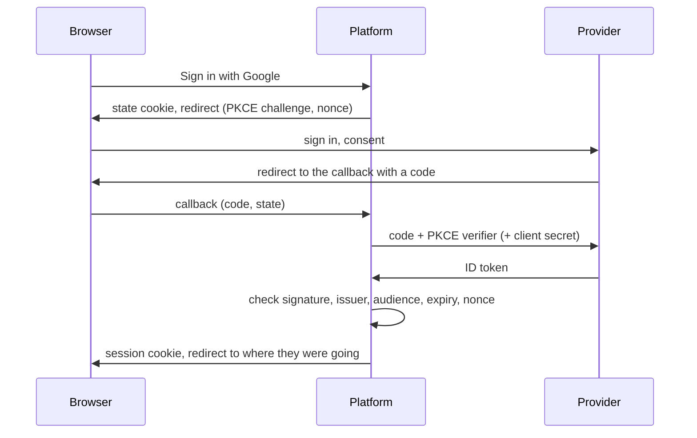

# Sign-in with other accounts

People can sign in with an account they already have elsewhere, with Google, Microsoft 365, Keycloak, Okta or any other OpenID Connect provider (D-70). Each provider an admin turns on is a **Sign in with …** button on the login page. Passwords and [school sign-in](directory.md) keep working beside them. An admin sets it up in **Admin → Sign-in**.

## How a sign-in works

- **The code flow with PKCE**, plus a nonce and a state cookie. A callback link made in another browser, or reused, is refused, so nobody can be signed in as somebody else.
- **The ID token is checked** against the provider's published keys: signature, issuer, audience (your client ID), expiry and nonce. The provider's discovery document and keys are reused for an hour, and fetched again when a token doesn't verify.
- **The client secret** is sealed with the master key, as LLM keys and the directory password are (ADR-09). It's never shown again after saving.
- **One redirect URL for every provider:** `https://quiz.example.edu/api/auth/oidc/callback`. The admin page shows yours, with a Copy button.

## Which account a sign-in opens

1. **A sign-in seen before** opens the same account. The provider's subject id decides this, not the email, so a changed email still opens the right account.
2. **Otherwise, the same email.** A student or teacher account with the same email is joined on the first sign-in, if the provider allows it (**Existing accounts: Sign them in**). The account's password keeps working. Admins, managers and school-directory accounts are never joined by email; they connect from their account page.
3. **Otherwise, a new account**, if the provider makes them (**People without an account**). It's a student or a teacher account, as you choose. With a **teachers by claim** rule, new accounts whose `groups` (or other claim) contain one of your values become teachers. New teachers wait for approval if your policy asks for it (**Platform settings**). New accounts have no password; their owners can set one with **Forgot password**.
4. **Otherwise, no sign-in.** The login page says why.

The email must be confirmed by the provider for steps 2 and 3 (`email_verified`). Microsoft doesn't send that claim. For a provider your school runs, where people can't choose their own address, set **Unconfirmed emails: Trust them**.

**Email domains** limit a provider to your school's addresses. Set them for Google, or anyone with a Gmail account could sign in, or join an account whose email they control.

Roles come from the platform once the account exists: a provider never changes them.

## Connecting from the account page

**Your account → Sign-in with other accounts** lists the providers connected to the account, and lets people connect others. Connecting works whatever the email at the provider, because the person has proved both. A sign-in belongs to one account only. People can disconnect a sign-in, unless it's the only way into their account: they set a password first.

## Setting up a provider

In every case, register the platform as a **web application** with the provider, with the redirect URL from the admin page. Copy its client ID and secret into **Admin → Sign-in → Add a provider**, press **Test** next to the issuer, then **Save and turn on**.

### Google

1. In the Google Cloud console, open **APIs & Services → OAuth consent screen**. Choose **Internal** for Google Workspace (only your domain's accounts), or External.
2. **Credentials → Create credentials → OAuth client ID → Web application.** Under **Authorised redirect URIs**, add the redirect URL.
3. Use the **Google** preset (issuer `https://accounts.google.com`), and put your domain in **Email domains**.

### Microsoft 365 (Entra ID)

1. In the Entra admin centre, open **App registrations → New registration**. Choose *Accounts in this organisational directory only*, and add the redirect URL as a **Web** redirect URI.
2. **Certificates & secrets → New client secret.** Note when it expires: sign-in stops working then, until you paste a new one.
3. Use the **Microsoft** preset, and replace `TENANT-ID` in the issuer with the *Directory (tenant) ID*. The preset reads the email from `preferred_username` and trusts it.
4. For teachers by group, add a **groups claim** under *Token configuration* and use the group object IDs as teacher values.

### Keycloak

1. Create a client with **Client authentication** on, the standard flow, and the redirect URL as a valid redirect URI.
2. The issuer is `https://keycloak.example.edu/realms/REALM`. For teachers by group, add a *Group Membership* mapper with the claim name `groups`.

A Keycloak on the same machine may use `http://localhost`. Every other issuer must use HTTPS.

## Configuration

Nothing is set in the environment: providers are kept in the database (schema `oidc`), and their secrets are sealed with the master key, so a backup restored with another key loses them. The server must reach each issuer over HTTPS, outbound.

**Content-Security-Policy:** sign-in is a full-page redirect, so the CSP needs no change.

## Troubleshooting

| What people see | Why |
|---|---|
| *That sign-in took too long or was started in another tab* | More than 10 minutes at the provider, a second tab, or blocked cookies. Start again |
| *There's no account here for that sign-in* | The provider makes no new accounts. Create the account, or let them connect from their account page |
| *An account with that email already exists* | Joining by email is off, or it's an admin, manager or school-directory account. Connect from the account page |
| *That account's email domain isn't allowed* | The email isn't at one of the provider's domains |
| *The provider didn't confirm your email address* | No `email_verified`. For your own provider, trust its emails |
| *Sign-in didn't work* | Look at the server log (`sign-in with a provider failed`): usually a wrong or expired client secret, or a redirect URL the provider doesn't have |
