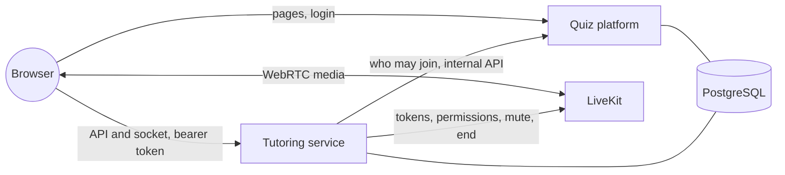

# Tutoring sessions

Code: `tutoring/` (a separate Go module and program, schema `tutoring`), `backend/internal/tutorlink` (the platform's side) and `frontend/src/lib/tutoring`, `frontend/src/routes/tutor`, `frontend/src/routes/t/tutoring`. Decisions: D-58 (LiveKit), D-59 (this design), D-60 (backstage, the broadcaster, co-teachers), D-79 (breakout groups), D-80 (recording).

A tutoring session is a live online class in a desktop browser: the teacher broadcasts screens, cameras and voice to the class, students watch, chat and raise their hand, and speak or share only when the teacher allows it. It runs as its **own service** beside the quiz platform, so a busy or failing tutoring session can't slow down or stop a live quiz (ADR-18, PO-5).

## The pieces



| Piece | Does |
|---|---|
| Quiz platform | Logs people in and signs a **5-minute token** naming them (`POST /api/tutoring/token`). Answers the tutoring service's question "may this person take part in this classroom?" on `/internal/tutoring/access`, which isn't under `/api`, so the public proxy never forwards it. |
| Tutoring service | Sessions, the waiting room, permissions, hands, chat and attendance, in its own schema. Decides who may publish what and tells LiveKit. Never reads the platform's tables (TS-NFR-51). |
| LiveKit | Receives each track once and forwards it to everyone allowed to see it, in a few quality levels (simulcast). It never re-encodes. |
| Pages | `/t/tutoring` (the teacher's sessions) and `/tutor/CODE` (the room), in the platform's own frontend. `livekit-client` loads only on the room page. |

## Signing in

1. The page asks the platform for a token: HS256, issuer `quiz-platform`, audience `tutoring`, 5 minutes, naming the person's id, name and role.
2. Every call to the tutoring service carries it as `Authorization: Bearer …`. There are no tutoring cookies, so there is nothing to forge across sites.
3. The socket can't carry headers, so its first message is `{"token": "…"}`. The page sends a fresh token every 4 minutes; a socket whose token runs out is closed. Logging out of the platform therefore ends tutoring access within minutes (TS-NFR-52).
4. The tutoring service calls the platform with its own one-minute tokens (issuer `tutoring`, audience `quiz-platform`). Neither kind of token is accepted the other way round.

Both kinds are signed with **one shared secret file**: `QP_TUTORING_SECRET_FILE` on the platform, `TUTOR_SECRET_FILE` on the tutoring service. It is kept like the master key: a file, mode 0400, never an environment variable.

## A session

| Step | What happens |
|---|---|
| Create | A teacher creates a session for one of their classrooms (the platform confirms they teach it). It gets an 8-character join code and a link `/tutor/CODE`. |
| Join | A student opens the link while logged in, on a computer (phones and tablets see "Tutoring sessions need a computer"). The platform checks the classroom: enrolled students may join, and joining may enrol them as joining a quiz does (BR-02). There are no guests. |
| Wait | With "students wait until I admit them", students wait until the teacher admits them; otherwise they go straight in. Before the teacher starts, admitted students see "The session starts when the teacher starts it". |
| Start | The session goes live; attendance starts for everyone connected. |
| Teach | The teacher shares screens (several at once), cameras (several at once) and the microphone. Students see the teacher's tracks; screens fit whole, cameras fill their tile, and any track can go full screen. |
| End | Everyone is disconnected, the media room is deleted, and the session can't be joined again. |

One socket per person and session: a second tab replaces the first, which shows "You opened this session in another tab".

## Two media rooms: the broadcast and backstage

Every session has two LiveKit rooms (D-60):

| Room | Who publishes | Who watches |
|---|---|---|
| The broadcast (the session's id) | the broadcaster: the lead teacher, or the person they handed it to; and the lead teacher's microphone while someone else broadcasts | everyone |
| Backstage (`<id>-stage`) | students the teacher allowed to share, and co-teachers | the lead teacher and co-teachers only |

The tokens say so: a student's backstage token has `canSubscribe: false`, so no browser, however modified, receives another student's camera or screen (TS-FR-37, TS-NFR-22). The page shows backstage tracks to teachers under "Shared with the teachers only", and a student's own under "What you share: only your teachers see it".

## Handing over the broadcast

The lead teacher can make a student or a co-teacher the broadcaster (TS-FR-17):

1. "Make broadcaster" sends them an offer; nothing changes until they answer.
2. If they accept, they may publish everything in the broadcast, the previous broadcaster stops, and the lead teacher keeps only the microphone there, so they can still speak to everyone. The person starts sharing with their own click (PO-3).
3. If they decline, the teacher is told.
4. "Take the broadcast back" ends it in one step; the person's broadcast tracks stop.

LiveKit carries each change out at once: taking a source's permission away removes the participant's published tracks of that source.

## Co-teachers

The lead teacher adds other teachers by their email (the platform confirms an active teacher account) (TS-FR-70). Co-teachers join with the link without being in the classroom, see the people panel and backstage, and admit, allow, mute, lower hands, moderate the chat and read attendance (TS-FR-71). Only the lead teacher starts and ends, locks, changes how students are admitted and the layout, removes students, chooses the broadcaster and adds or removes co-teachers. Co-teachers share backstage, where the teachers see them, and to the class only as the broadcaster (TS-FR-72). Students see who teaches: the lead teacher and co-teachers are named in the session's header (TS-FR-73).

## Breakout groups

The lead teacher makes groups (TS-FR-50): at random (a number of groups, or students per group), from the classroom's categories (the platform's `/internal/tutoring/categories`; a student in two goes to the first, the rest to "Others"), empty groups to fill by hand, or groups students choose themselves. Making groups again replaces them; they can be made before the session starts.

Opening the groups (TS-FR-51) puts every placed student in their group's own media room (`{session}-g{group}`). Its members publish what they may in the main room plus what the lead teacher allows everyone in groups (microphones by default; cameras and screens when turned on, TS-FR-53), and they see and hear each other there, which TS-FR-37 allows within a group. Everyone stays in the main broadcast too, so the teacher can still speak to all groups at once; "Message to every group" also sends a chat announcement. Teachers visit a group by joining its room, where they are seen and heard (TS-FR-52), and move students between groups: the student leaves the old room at once (`RemoveParticipant`) and the page joins the new one. A student can ask for help (TS-FR-54); the teachers see it until they visit or dismiss it.

Each group has its own chat (TS-FR-46, PO-14), on by default even when the main chat is off; the lead teacher can turn it off. A group's messages reach its members and the teachers, and students are told the teachers can read them.

Closing brings everyone back, at once or after a countdown of up to 5 minutes that everyone sees; the group rooms then end. A countdown that runs out while the service is down is closed when it starts again (and a sweep every 30 s catches any missed one). Ending the session ends the group rooms too.

## Recording

The lead teacher or a co-teacher presses **Record** (TS-FR-75). The recording is made in that teacher's browser (`lib/tutoring/recorder.svelte.ts`), not on the server: every frame draws the current broadcaster's screen share onto a 1280×720 canvas (a card saying "isn't sharing a screen" when there is none), and their microphone and screen sound are mixed into one audio track, so it follows the broadcast as it changes hands (TS-FR-77). Cameras, other people's microphones, groups, chat and the whiteboard are never recorded. `MediaRecorder` makes WebM (or MP4) parts every 5 seconds, which are uploaded in order to `PUT /api/sessions/{id}/recordings/{rec}/chunks/{n}` (a retry of the same part is accepted). If that tab closes, what was uploaded is kept, and the service stops a recording that has been quiet for 2 minutes. The browser throttles a tab in the background, so the recording teacher should keep the session's tab in front.

Everyone sees **● Recording** while it runs, including students in the waiting room, and the presenter is told their screen and voice are recorded (TS-FR-76); nobody is asked for consent (PO-21). Pause and resume keep the indicator.

The service never re-encodes a recording. Each part is encrypted with AES-256-GCM (a key derived from the shared secret with HKDF; the recording's id and the part's number are bound in) and appended to `TUTOR_RECORDINGS_DIR/{id}.rec` (TS-NFR-24). Recordings play in the browser from 5-minute signed links (`/media/recordings/{id}?exp=…&sig=…`), since a `<video>` can't send a token; the platform's CSP needs the tutoring address in `media-src`. The session's teachers can watch; students only when the lead teacher chooses "Students too" (TS-FR-78). Only the lead teacher and the admin download. Students find recordings they may watch on their My page, and teachers find theirs on the Tutoring page.

Each recording is deleted 2 days after it ends (PO-22), by a sweep every 30 s. All recordings together may use 5 GB by default; the admin's **Tutoring** tab shows the space and every recording, deletes any, and changes the limit, up to the free disk space (PO-24, TS-FR-79). Teachers are told at 80 %, and a recording stops when the space is full.

## The bandwidth budget

Live video costs the server upload: each track goes once to everyone who receives it. LiveKit doesn't report bandwidth per room, so the service estimates each live session's use every 2 seconds from what it publishes (`ListParticipants` on the broadcast, backstage and each group room) and how many receive it, at typical rates per receiver (D-81):

| Track | Mbit/s per receiver |
|---|---|
| A readable screen (1080p, low frame rate) | 1.2 |
| A smooth screen (higher frame rate) | 2.5 |
| A camera | 0.4 |
| A second screen or camera, as a thumbnail | 0.2 |
| A voice | 0.04 |

What students share backstage counts once per teacher; a group's tracks once per other member. Everything shown says "estimated".

**The admin's budget** (the admin console's **Tutoring** tab, TS-FR-31): all sessions together (240 Mbit/s by default, PO-9), a hard limit nothing goes above (270), an optional share per session, how many screens and cameras the broadcaster may send (4), and how many students may share a camera or a screen at once (2, and never fewer, TS-FR-25). Changes apply at once. The tab also lists what each live session sends now.

**Plans** (TS-FR-08). Each session has a plan: expected students, the broadcaster's screens and cameras, screen quality, students sharing and speaking at once, and cameras in groups. The default is a lecture: 30 students, one screen and a camera, two students sharing (about 56 Mbit/s). The Resources tab shows the forecast against what is free, with advice when it doesn't fit ("send no camera", "plan for at most 188 students"); teachers save plans they use often as presets.

**Checks** (TS-FR-32). Starting a session, letting another student share a camera or screen, turning on video in open groups, and the broadcaster adding a screen or camera (`POST /api/sessions/{id}/budget/track`) are checked against the session's share of what's free. Over the budget, the teacher may go ahead anyway, up to the hard limit; each override is logged.

**When it's over** (TS-FR-38). If all of tutoring stays over the budget for two checks in a row (over 3 s), the busiest session gives up one thing, then the next if it's still over, in this order:

1. cameras and screens in breakout groups;
2. students sharing a camera or screen, beyond the first two;
3. the broadcaster's extra screens and cameras;
4. the broadcaster's camera;
5. the screen, down to 5 frames a second.

LiveKit mutes the tracks at once, and the broadcaster's browser stops sending them. The teachers are told what was switched off and why, and the Resources tab lists it. Nothing comes back by itself (TS-FR-39): once tutoring is below 80 % of the budget, the teachers are told once, and turn each thing back on, which is checked against the budget again.

The Resources tab (teachers, TS-FR-33) shows the session's use and its share, all of tutoring against the budget, what makes up the figure, and the plan.

## Monitoring

The admin console's **Tutoring** tab shows upload, download, CPU, tracks, participants and reconnects, in total and for each live session, now and over the last 24 hours or 7 days (D-82, TS-NFR-41).

- **Measured or estimated.** LiveKit reports nothing per room. With `prometheus: port:` in LiveKit's config and `LIVEKIT_METRICS_URL` for the tutoring service, the totals are measured from LiveKit's own counters (bytes sent and received, its process's CPU) every 2 seconds. Each session's figures are the estimates above; its CPU is the measured CPU shared out by its upload. Without the metrics, everything is estimated, and the page says so. Keep the metrics port closed to the outside.
- **Reconnects** count a person's connection to the session coming back, and their page joining the video again after it dropped.
- **History.** While anything is live, a row a minute is saved for all of tutoring and for each session (the minute's averages, the most tracks and people, the reconnects), and kept 7 days. The charts show 5-minute points for a day and 30-minute points for a week; below them, each session's peaks.

## The relay on port 443

Video normally travels over UDP 7882 (TCP 7881 as a fallback). Some school networks let nothing out but HTTPS, so LiveKit's own TURN relay also runs behind port 443 (D-83, TS-NFR-12):

- LiveKit tells browsers about `turns:turn.example.edu:443` (`turn` in `deploy/livekit.yaml`, with `external_tls: true`). A browser that can't reach the media ports sends the video through the relay, over TLS on 443, like any HTTPS connection.
- Port 443 is shared by name. Caddy, built with the [layer4 plugin](https://github.com/mholt/caddy-l4), takes connections for the relay's name, ends TLS with its own automatic certificate and passes them to LiveKit on 5349; every other name reaches the sites as before (`deploy/Caddyfile`). Compose builds that Caddy (`deploy/container/caddy.Dockerfile`); set `QP_TURN_DOMAIN` and enable `turn` in `deploy/container/livekit.yaml`. With aaPanel's nginx, the stream module does the same split (`deploy/aapanel/nginx-turn.conf`); this moves every HTTPS site to an internal port, so read its steps first.
- LiveKit's relay refuses to forward to private or loopback addresses (`turn.allow_restricted_peer_cidrs` lists exceptions). A server with a public address needs nothing; a school running everything on its own network adds its LiveKit address there.
- **Checking it:** open a session link with `?relay=1`. The page says "Relay only" and sends and receives video only through the relay, as from behind such a firewall.

Tested on one computer with Caddy 2.11.7 and caddy-l4 0.1.2 in front of LiveKit 1.13.7: with `?relay=1`, Chrome watched the teacher's screen through `turns:…:443` over TLS (`tutor-relay.mjs`). The aaPanel config was not tried on aaPanel.

## Layout

The lead teacher chooses what students see: spotlight (the main track large, the others small), side by side, or a grid; the choice reaches students at once. A student can pick another layout for themself until the teacher changes it again (TS-FR-13).

## What students may share

Nothing, by default (TS-FR-20). The teacher allows the microphone, camera and screen separately, per student or for everyone, from the People tab or the hand queue:

- **The server decides.** Each LiveKit token lists exactly the sources its holder may publish in each room, and a change is sent to LiveKit at once (`UpdateParticipant`, both rooms), which removes a track whose permission was taken back. A modified browser can't publish more than it was allowed (TS-NFR-22).
- **Allowing isn't switching on** (PO-3). The student turns their own device on, after their own click and the browser's prompt. "Ask to turn on" shows the student a request they can accept or decline, and the teachers see the answer (TS-FR-22); nothing turns on by itself.
- **Raised hands** queue in order. "Allow mic" in the queue grants the microphone, asks the student and lowers the hand in one step.
- **Mute** mutes a student's published tracks of the chosen kind, or everyone's microphones at once.
- What students share goes backstage, to the teachers only, unless they are the broadcaster (above).

## Chat

Plain text up to 1,000 characters, with links shown as links and never as HTML (TS-FR-43). The teacher chooses the mode, and can change it at any time:

| Mode | Students |
|---|---|
| Students to teacher only (default) | write questions only teachers see |
| Everyone | write to the whole room |
| Teacher announcements only | read only |
| Off | no chat |

Teachers can reply to one student privately, delete a message for everyone, mute one student in the chat, set slow mode (one message per N seconds per student) and pin a message. Late joiners get the history they may see. Chat goes through the tutoring service, not LiveKit, so it keeps working when the media server is down (TS-NFR-13). Deletions, removals, permission and chat-mute changes are written to the session's log (TS-NFR-42).

## Attendance

Attendance counts the time each person was connected while the session was live: first joined, last left, how many times they connected, and their total minutes. The teacher sees it in the Attendance tab and downloads it as CSV (formula-like names are escaped). A restart of the tutoring service closes the visits that were open; people reconnect and open new ones.

## Running it locally

Run the platform with tutoring on, the tutoring service, and LiveKit:

```sh
# in backend/: a shared secret and a LiveKit secret, once (.data is git-ignored)
openssl rand -hex 32 > .data/tutoring.secret
printf 'tutoring: %s\n' "$(openssl rand -hex 24)" > .data/livekit-keys.yaml

# LiveKit (from the pinned build the load test downloads, loadtest/.bin)
livekit-server --config .data/livekit.yaml   # the config below

# the platform
QP_TUTORING_URL=http://localhost:8090 QP_TUTORING_SECRET_FILE=.data/tutoring.secret … go run ./cmd/server

# the tutoring service
cd tutoring
TUTOR_DATABASE_URL=… TUTOR_SECRET_FILE=../backend/.data/tutoring.secret \
TUTOR_PLATFORM_URL=http://127.0.0.1:8080 TUTOR_PLATFORM_ORIGIN=http://localhost:8080 \
LIVEKIT_URL=http://127.0.0.1:7880 LIVEKIT_PUBLIC_URL=ws://127.0.0.1:7880 \
LIVEKIT_API_KEY=tutoring LIVEKIT_API_SECRET_FILE=../backend/.data/livekit-keys.yaml go run ./cmd/tutor
```

`.data/livekit.yaml` for one computer. It offers browsers only the loopback address: left to itself, LiveKit also offers every other address of the computer, and where those change (Windows rotates its temporary IPv6 addresses) Chrome stops with "could not establish pc connection".

```yaml
port: 7880
bind_addresses: ["127.0.0.1"]
rtc:
  tcp_port: 7881
  udp_port: 7882
  node_ip: 127.0.0.1
  use_external_ip: false
  enable_loopback_candidate: true
  ips:
    includes: ["127.0.0.1/32"]
key_file: livekit-keys.yaml   # mode 0400; on Windows, which can't set that, write the key inline: keys: {tutoring: <secret>}
```

If Windows refuses the ports (`netsh interface ipv4 show excludedportrange protocol=tcp` lists the reserved ranges), move all three, and the `LIVEKIT_*` addresses with them.

| Variable | Default | Meaning |
|---|---|---|
| `TUTOR_LISTEN` | `127.0.0.1:8090` | Where the service listens |
| `TUTOR_DATABASE_URL` | — | PostgreSQL; the service uses only its own `tutoring` schema |
| `TUTOR_SECRET_FILE` | — | The secret shared with the platform |
| `TUTOR_PLATFORM_URL` | — | The platform on the server's own network, for the internal API |
| `TUTOR_PLATFORM_ORIGIN` | — | Where the platform's pages come from: the only origin allowed to call the service (CORS, socket origin) |
| `LIVEKIT_URL` | `http://127.0.0.1:7880` | LiveKit's server API |
| `LIVEKIT_PUBLIC_URL` | — | What browsers connect to, e.g. `wss://tutor.example.edu` |
| `LIVEKIT_API_KEY`, `LIVEKIT_API_SECRET_FILE` | — | LiveKit's key and its secret file: just the secret, or LiveKit's own `key: secret` key file |
| `TUTOR_GENERATE_LIVEKIT_KEYS` | off | `1`: write the LiveKit key file on first start (containers) |
| `LIVEKIT_METRICS_URL` | — | LiveKit's Prometheus endpoint (`prometheus: port:` in its config), e.g. `http://127.0.0.1:6789/metrics`: measured bandwidth and CPU for monitoring (D-82) |
| `TUTOR_RECORDINGS_DIR` | `data/recordings` | Where recordings are kept, encrypted (D-80); the systemd unit uses `/var/lib/quiz-tutoring/recordings`, containers `/var/lib/tutoring/recordings` |

Windows sometimes reserves a range of ports around 7880 (`netsh interface ipv4 show excludedportrange protocol=tcp`); run LiveKit on other ports then.

## Tests

- `tutoring/internal/tutor`: the service against PostgreSQL, a fake platform and a fake LiveKit: creating and listing, joining, admitting, refusing, locking, removing, starting and ending; the sources and watching rights in each room's token; permission changes reaching LiveKit in both rooms; hands, mute; every chat mode, private replies, deletion, pinning, slow mode; sockets (one per person, origins, the first message) and attendance; co-teachers' rights and limits; handing the broadcast over, declining and taking it back; answers to requests; the layout; breakout groups; recording; plans and presets, the admin's budget, the checks before starting and sharing, and the monitor switching things off in order and turning them back on (`budget_api_test.go`, with tracks set per room in the fake LiveKit); monitoring, with a fake of LiveKit's metrics whose counters the test moves on (`metrics_api_test.go`).
- `backend/internal/tutorlink`: tokens, the internal API and every way a service token is refused.
- `loadtest/tutoring-media.mjs`: LiveKit's capacity on this machine (D-58). Run it with nothing else busy: the simulated viewers share the machine's cores.

## Not yet

Later phases add: scheduling and reminders, the whiteboard and polls inside a session, attendance reports for classrooms, and a TURN relay on port 443 for school firewalls.
